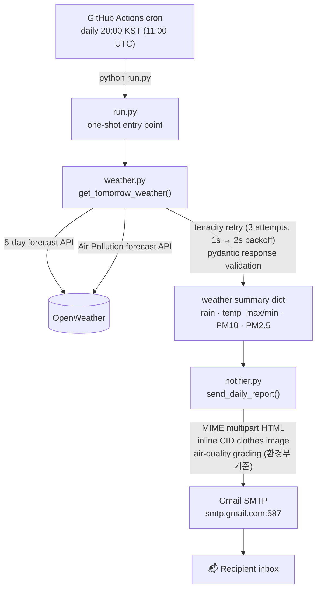

# teruterubozu

[](https://github.com/nonasking/teruterubozu/actions/workflows/ci.yml)
[](https://codecov.io/gh/nonasking/teruterubozu)
[](https://www.python.org/downloads/)


A weather notification service that automatically checks tomorrow's forecast (rain, high/low temperature, fine dust) every day at 20:00 KST and delivers it as an HTML email.

## Highlights

- **Auto-recovery from upstream failures** — exponential backoff retry on OpenWeather 5xx / network errors (tenacity, 3 attempts, waiting 1s then 2s); 4xx fails fast to surface bad coordinates or auth immediately.
- **Schema drift guard** — pydantic validates the fields the pipeline depends on, so any OpenWeather breaking change raises `ValidationError` instead of silently corrupting the email.

## Architecture



> **Note on the FastAPI server:** the production path is the GitHub Actions cron job invoking `run.py` as a one-shot script — no server runs anywhere. `backend/main.py` (FastAPI) and `backend/scheduler.py` (APScheduler) exist as an alternative self-hosted mode you can run locally, but they are not part of the deployed surface.

## Tech Stack

- **Python** 3.11+
- **FastAPI** — optional self-hosted HTTP server (not used in the deployed Actions path)
- **APScheduler** — daily scheduler for the self-hosted mode (runs every day at 20:00)
- **OpenWeather API** — weather data ([5-day forecast](https://openweathermap.org/forecast5), [Air Pollution](https://openweathermap.org/api/air-pollution), free tier)
- **pydantic** — response schema validation (schema drift guard)
- **tenacity** — exponential backoff retry on transient upstream failures
- **Gmail SMTP** — email delivery (Python standard library, no cost)
- **GitHub Actions** — free deployment (auto-runs daily at 20:00 KST) and CI (ruff + pytest + Codecov)
- **pytest** — test suite (41 tests, coverage reported to Codecov)
- **Poetry** — dependency management

## Project Structure

```
teruterubozu/
├── backend/
│   ├── main.py        # FastAPI entry point, registers scheduler lifespan
│   ├── scheduler.py   # APScheduler setup and job registration
│   ├── weather.py     # OpenWeather API client
│   └── notifier.py    # Gmail SMTP email notifier
├── tests/
│   ├── test_weather.py    # OpenWeather client, retry policy, schema validation
│   ├── test_notifier.py   # air-quality grading, MIME structure, SMTP send
│   └── test_scheduler.py  # APScheduler job registration (self-hosted mode)
├── assets/
│   └── clothes_per_temperature.jpg  # Clothing guide by temperature
├── .github/
│   └── workflows/
│       ├── weather-check.yml  # GitHub Actions deployment workflow (daily cron)
│       └── ci.yml             # Lint (ruff) + tests (pytest) + coverage upload
├── run.py             # Entry point used by GitHub Actions
├── .env.example       # Environment variable template
├── pyproject.toml
└── poetry.lock
```

## Deployment (GitHub Actions)

The job runs daily at 20:00 KST via the GitHub Actions cron scheduler — no server required, **completely free**.

### 1. Register GitHub Secrets

In your GitHub repository → **Settings → Secrets and variables → Actions**, add the following:

| Secret | Required | Description |
|---|:---:|---|
| `OPENWEATHER_API_KEY` | ✓ | [OpenWeather](https://openweathermap.org/api) API key |
| `OPENWEATHER_LAT` | ✓ | Latitude of the target location (default: `37.5665`, Seoul) |
| `OPENWEATHER_LON` | ✓ | Longitude of the target location (default: `126.9780`, Seoul) |
| `GMAIL_USER` | ✓ | Sender Gmail address |
| `GMAIL_APP_PASSWORD` | ✓ | Gmail App Password ([how to issue](#issue-a-gmail-app-password)) |
| `NOTIFY_TO_EMAIL` | ✓ | Recipient email address |
| `CLOTHES_IMAGE_PATH` | | Path to the clothing-guide image (image section is omitted if unset) |

### 2. Manual Run (Testing)

GitHub repository → **Actions → Daily Weather Check → Run workflow**

### Issue a Gmail App Password

1. Google Account → **Security** → enable **2-Step Verification**
2. **App passwords** → enter an app name → copy the 16-character password (paste without spaces)

## Local Run

### 1. Install dependencies

```bash
poetry install --no-root
```

### 2. Configure environment variables

```bash
cp .env.example .env
```

Open `.env` and fill in the values.

### 3. Run

```bash
# One-shot: fetch weather and send the email
poetry run python run.py

# Run the FastAPI server (with the scheduler attached)
poetry run uvicorn backend.main:app --reload
```

## Testing

41 tests cover the OpenWeather client (retry policy, schema validation, tomorrow-filtering), the email notifier (air-quality grading, MIME structure, inline image fallback), and the scheduler. No network calls or real SMTP connections are made — everything is mocked.

```bash
# Install dev dependencies (pytest, pytest-cov, ruff)
poetry install --no-root --with dev

# Run the suite (coverage is reported automatically)
poetry run pytest

# Lint, as CI does
poetry run ruff check .
```

The same two steps run on every push via the `CI` workflow.

## How It Works

1. Every day at 20:00, `get_tomorrow_weather()` calls the OpenWeather API.
   - **5-day forecast API**: rain forecast, high/low temperature
   - **Air Pollution API**: PM10 and PM2.5 concentrations
2. `send_daily_report()` sends the collected weather data as an HTML email.
   - The subject changes based on the rain forecast (☔ / ☀️)
   - Air-quality grades follow the Korean Ministry of Environment standard (Good / Moderate / Unhealthy / Very Unhealthy)
   - When `CLOTHES_IMAGE_PATH` is set, the clothing-by-temperature guide is embedded at the bottom of the email
